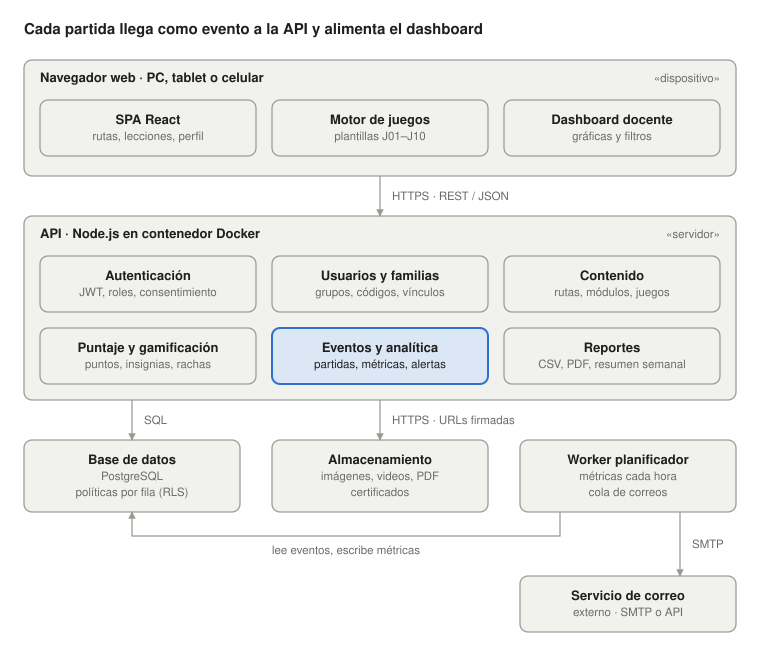

  

<h1 align="center">CiberFamilias</h1>

  Plataforma de aprendizaje en ciberseguridad, minimalista y gamificada, para estudiantes de grado 10.° y 11.° y sus familias. 
  <em>Semillero Spyware</em>

---

## Objetivo

**Impartir conocimiento e informar a los estudiantes de grado 10.° y 11.° y a sus padres, madres y cuidadores sobre los riesgos del mundo digital**, y cómo prevenirlos, mediante contenido dinámico y juegos interactivos en vez de material estático.

Los docentes cuentan con un dashboard para medir el avance, saber qué actividades gustaron más, dónde se obtienen más puntos y en qué temas hay falencias.

## ¿Para quién es?

| Actor | Qué hace en la plataforma |
| --- | --- |
| Estudiante (10.° y 11.°) | Recorre la **Ruta Estudiantes** jugando y gana puntos e insignias |
| Padre, madre o cuidador | Recorre la **Ruta Padres** y acompaña el progreso de su hijo o hija |
| Docente | Asigna módulos, crea juegos y analiza resultados en el dashboard |
| Administrador | Gestiona instituciones, usuarios y el catálogo de módulos |

## Rutas de aprendizaje

| Ruta Padres (10 módulos) | Ruta Estudiantes (9 módulos) |
| --- | --- |
| Introducción del curso | Introducción |
| ¿Qué es un navegador y su uso? | Huella digital |
| Noticias falsas (Fake News) | Protección digital |
| ¿Qué es una identidad digital? | Control y seguridad de redes sociales |
| Cómo identificar delitos informáticos | Malware |
| Control y seguridad en redes sociales | Seguridad biométrica |
| Control parental | Seguridad en la nube |
| Aplicaciones de seguridad | Firewall |
| Ataques cibernéticos | Formulario |
| Dudas e inquietudes | |

Cada módulo combina micro-lecciones con juegos: crucigrama, sopa de letras, saltar la hoja, verdadero o falso, parejas, clasificar, ordenar pasos, ruleta, simulador de escenarios y cazador de phishing.

## Documentación

Toda la documentación de análisis y diseño está en [`docs/`](docs/README.md):

- [Visión general](docs/01-vision-general.md)
- [Actores](docs/02-actores.md)
- [Módulos de contenido](docs/03-modulos.md)
- [Mecánicas de juego](docs/04-mecanicas-de-juego.md)
- [Requisitos funcionales](docs/05-requisitos-funcionales.md)
- [Requisitos no funcionales](docs/06-requisitos-no-funcionales.md)
- [Casos de uso](docs/07-casos-de-uso.md)
- [Dashboard docente](docs/08-dashboard-docente.md)
- [Diagramas UML](docs/diagramas/README.md): casos de uso por actor, componentes y despliegue

## Estado del proyecto

Fase de análisis y diseño. Todavía no hay código de la aplicación.

## Arquitectura propuesta

  

Tecnologías sugeridas (sujetas a cambio): React en el cliente, Node.js en la API, PostgreSQL como base de datos y un worker programado para precalcular las métricas del dashboard.
