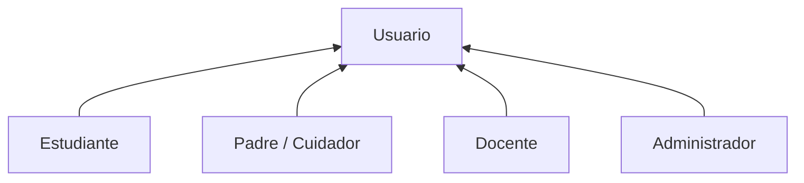

# 2. Actores

El sistema tiene cuatro actores humanos y dos actores de sistema. Todos los actores humanos heredan del actor genérico **Usuario**, que puede registrarse, iniciar sesión y editar su perfil.

| Actor | Tipo | Quién es | Objetivo principal |
| --- | --- | --- | --- |
| Estudiante | Primario | Joven de grado 10.° u 11.° (15 a 17 años) | Completar la Ruta Estudiantes jugando y ganar puntos e insignias |
| Padre / Cuidador | Primario | Padre, madre, acudiente o cuidador de un estudiante de 10.° u 11.° | Completar la Ruta Padres y acompañar el progreso de su hijo o hija |
| Docente | Primario | Profesor o líder del semillero a cargo de uno o más grupos | Asignar módulos, crear juegos y analizar avance y falencias |
| Administrador | Primario | Encargado técnico de la institución | Gestionar usuarios, instituciones, grupos y el catálogo de módulos |
| Servicio de correo | Secundario (sistema) | Proveedor SMTP o API de correo | Enviar invitaciones, recuperación de contraseña y resúmenes semanales |
| Planificador | Secundario (sistema) | Tarea programada (cron) | Calcular métricas agregadas y disparar recordatorios y alertas |

## Generalización

Diagrama UML fuente: [`diagramas/casos-de-uso/00-usuarios.puml`](diagramas/casos-de-uso/00-usuarios.puml).
