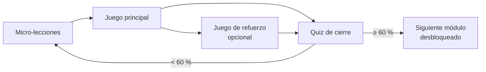

# 3. Módulos de contenido

Los 19 temas actuales del Semillero Spyware se convierten en módulos. Cada uno tiene 2 a 4 micro-lecciones, un juego principal evaluable y un quiz de cierre. Los juegos asignados son una propuesta inicial; el docente puede cambiarlos.

## 3.1 Ruta Padres (10 módulos)

| # | Módulo | Juego principal | Juego de refuerzo |
| --- | --- | --- | --- |
| P0 | Introducción del curso | Tour interactivo + trivia rápida | — |
| P1 | ¿Qué es un navegador y su uso? | Arrastrar y soltar (partes del navegador) | Sopa de letras |
| P2 | Noticias falsas (Fake News) | Verdadero o falso con deslizamiento | Saltar la hoja |
| P3 | ¿Qué es una identidad digital? | Crucigrama | Emparejar parejas |
| P4 | Cómo identificar delitos informáticos | Simulador de escenarios (¿qué harías?) | Clasificar en categorías |
| P5 | Control y seguridad en redes sociales | Configurador de privacidad simulado | Ruleta de preguntas |
| P6 | Control parental | Simulador de configuración de control parental | Ordenar pasos |
| P7 | Aplicaciones de seguridad | Emparejar app ↔ función | Sopa de letras |
| P8 | Ataques cibernéticos | Saltar la hoja (esquivar ataques) | Crucigrama |
| P9 | Dudas e inquietudes | Formulario de dudas + encuesta de satisfacción | — |

## 3.2 Ruta Estudiantes (9 módulos)

| # | Módulo | Juego principal | Juego de refuerzo |
| --- | --- | --- | --- |
| E0 | Introducción | Tour interactivo + trivia rápida | — |
| E1 | Huella digital | Detective de huella (encontrar datos expuestos en un perfil simulado) | Sopa de letras |
| E2 | Protección digital | Medidor de contraseñas (crear una clave fuerte) | Verdadero o falso |
| E3 | Control y seguridad de redes sociales | Cazador de phishing (¿mensaje real o falso?) | Ruleta de preguntas |
| E4 | Malware | Saltar la hoja (esquivar archivos infectados) | Crucigrama |
| E5 | Seguridad biométrica | Emparejar método biométrico ↔ ventaja o riesgo | Trivia contrarreloj |
| E6 | Seguridad en la nube | Clasificar archivos: compartir / privado / no subir | Sopa de letras |
| E7 | Firewall | Defensor del firewall (permitir o bloquear paquetes) | Crucigrama |
| E8 | Formulario | Encuesta final + calificación de juegos | — |

## 3.3 Estructura de un módulo

