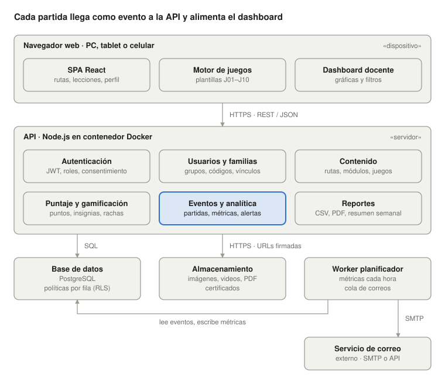
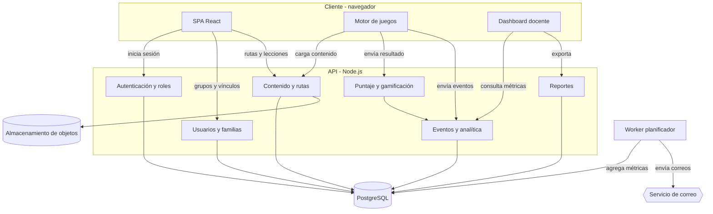
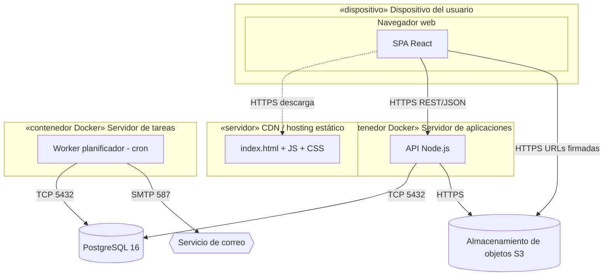

# Diagramas de componentes y de despliegue

La arquitectura propuesta tiene tres capas (navegador, API y datos) y un worker que precalcula las métricas del dashboard. Las tecnologías nombradas (React, Node.js, PostgreSQL) son una sugerencia y pueden cambiarse.

  

El motor de juegos envía cada acierto, error y abandono al componente de Eventos y analítica. El worker los agrega cada hora y el dashboard lee esos agregados. Las invitaciones y los resúmenes salen por una cola de correos que procesa el worker.

## Diagrama de componentes

Fuente UML: [`componentes.puml`](componentes.puml)

## Diagrama de despliegue

Fuente UML: [`despliegue.puml`](despliegue.puml)

