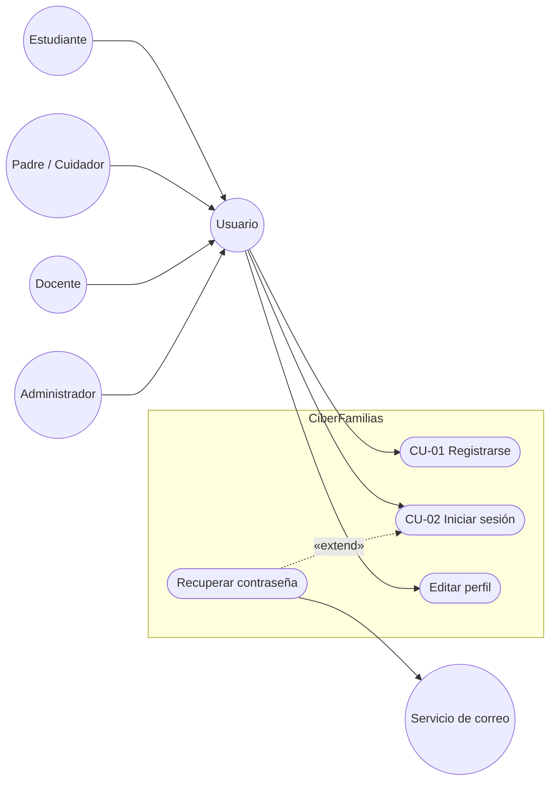
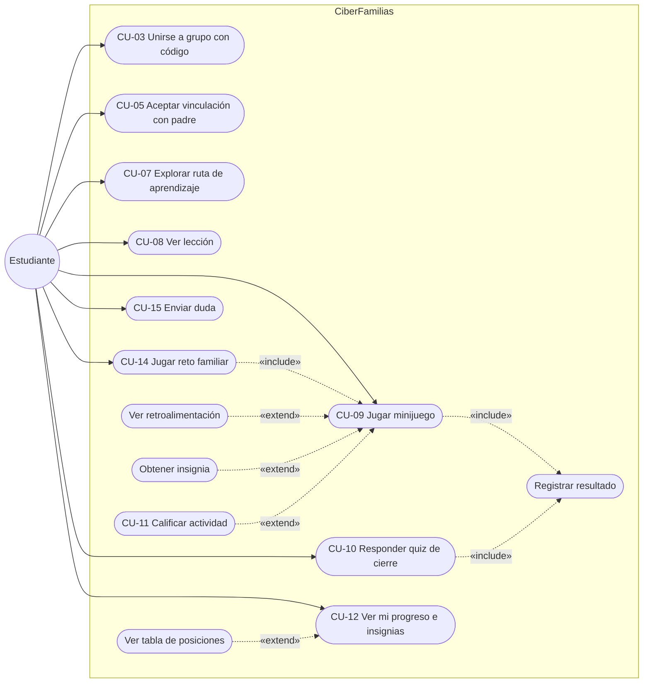
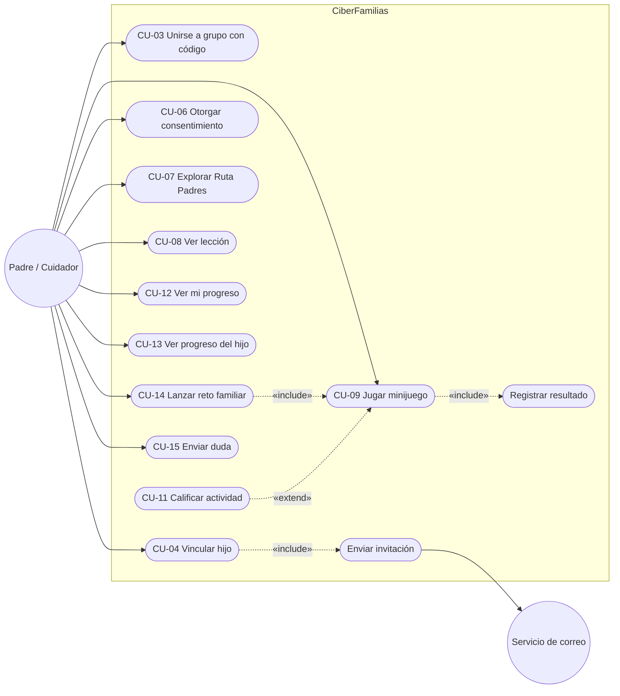
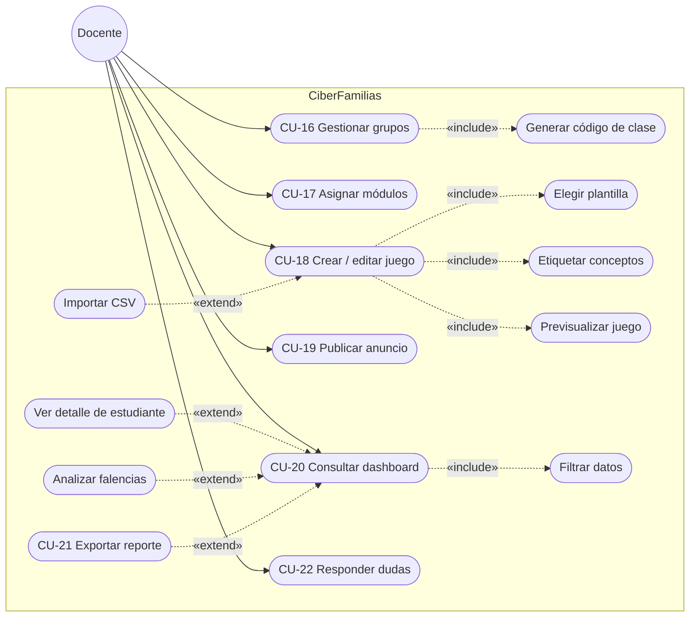
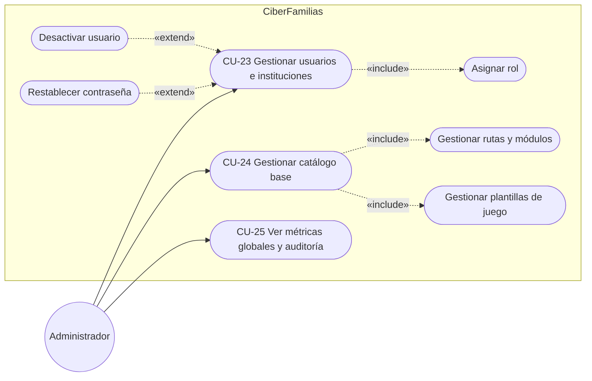
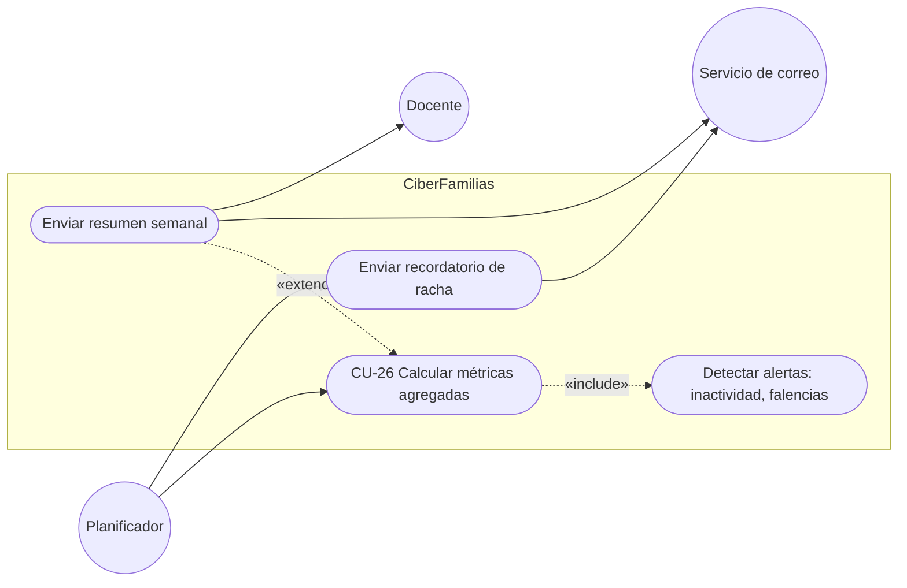

# Diagramas de casos de uso por actor

La fuente UML oficial de cada diagrama es su archivo `.puml` en [`casos-de-uso/`](casos-de-uso/). Debajo de cada enlace hay una vista previa en Mermaid, que GitHub muestra directamente.

Convenciones:

- Óvalo = caso de uso.
- Flecha continua = el actor participa en el caso.
- Flecha punteada `«include»`: va del caso base al caso incluido, que siempre se ejecuta.
- Flecha punteada `«extend»`: va de la extensión al caso base, y la extensión solo ocurre a veces.

## 1. Generalización de actores y casos comunes

Fuente: [`00-usuarios.puml`](casos-de-uso/00-usuarios.puml)

## 2. Estudiante

Fuente: [`01-estudiante.puml`](casos-de-uso/01-estudiante.puml)

## 3. Padre / Cuidador

Fuente: [`02-padre.puml`](casos-de-uso/02-padre.puml)

CU-13 requiere un vínculo activo, es decir, CU-04 aceptado por el estudiante en CU-05.

## 4. Docente

Fuente: [`03-docente.puml`](casos-de-uso/03-docente.puml)

## 5. Administrador

Fuente: [`04-administrador.puml`](casos-de-uso/04-administrador.puml)

## 6. Actores de sistema (Planificador y Servicio de correo)

Fuente: [`05-sistema.puml`](casos-de-uso/05-sistema.puml)

